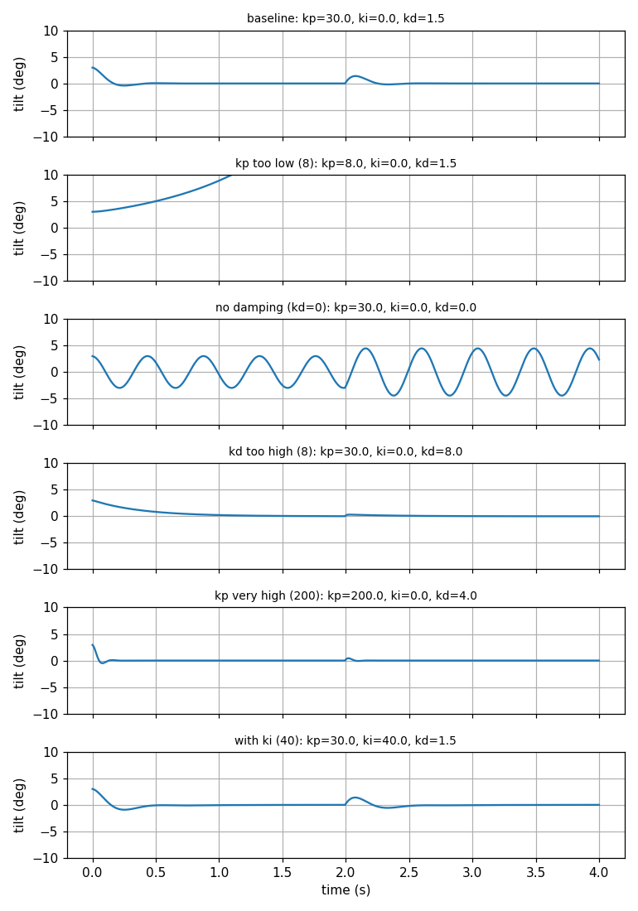
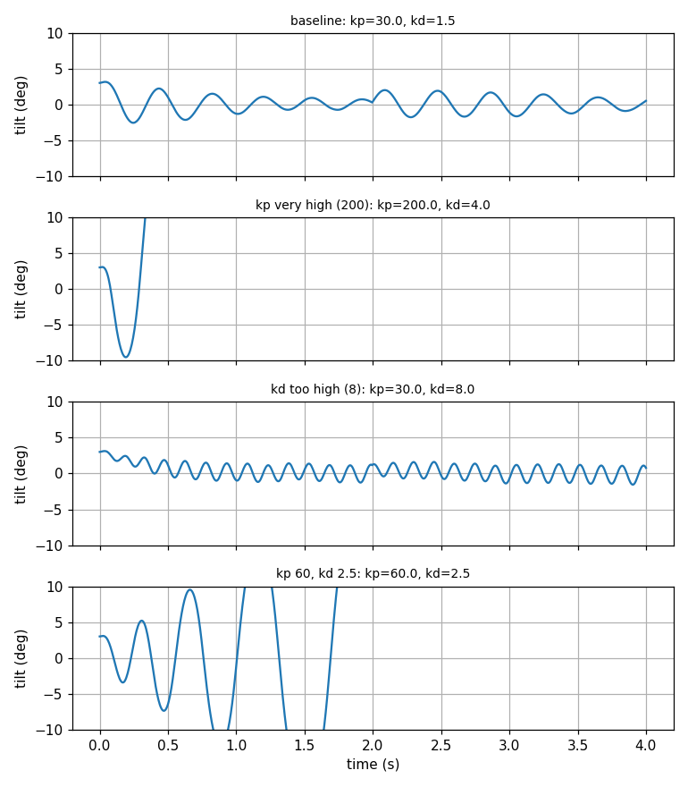
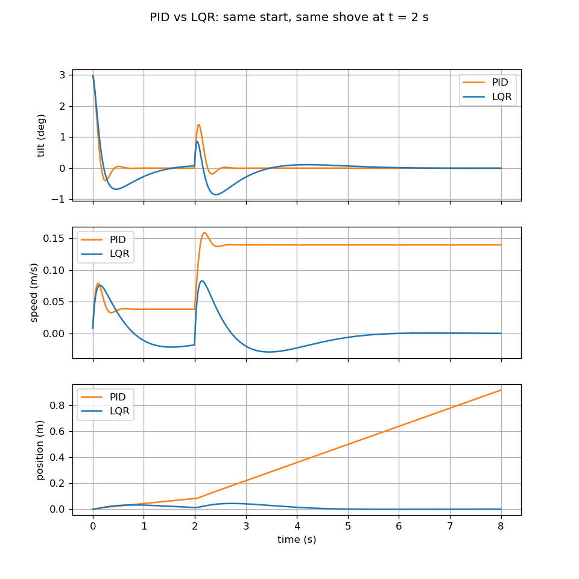
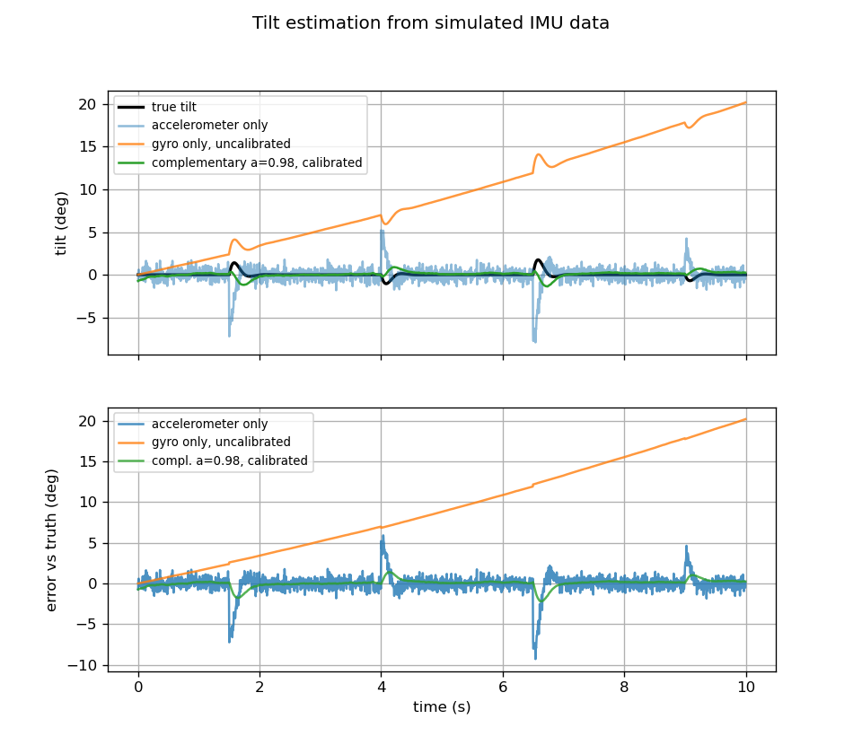

# balancebot

A self-balancing two-wheeled robot, built on an STM32 NUCLEO-F446RE and an MPU-6050 IMU.

**Status:** the simulation is done, and the tilt estimator and the balance loop (in dry-run mode, motors off) run on real hardware, including a FreeRTOS version of the loop with measured timing. The motor and encoder firmware is written and host-tested. The motors and the rest of the drivetrain parts are on order, so nothing that drives a motor has run yet. A parametric chassis is designed and ready to print.

## Simulation: the balancing problem first

Before buying motors, I modeled the robot as an inverted pendulum in Python and designed the controller on the model. The goal was to learn what each gain does and what limits them.

Model: the wheels accelerate the base by `a`, and the body (center of mass `L = 0.10 m` above the axle) tilts by `theta`:

    theta_ddot = (g * sin(theta) - a * cos(theta)) / L

The simulation steps at 200 Hz (5 ms), the loop rate planned for the Nucleo. Wheel acceleration is limited to 5 m/s^2.

| Script | What it does |
|---|---|
| `pendulum_fall.py` | No controller. A 3 degree lean falls over in 0.42 s. |
| `pid_balance.py` | PID controller holds the robot upright and recovers from a shove. |
| `gain_sweep.py` | Changes one gain at a time to show what each term does. |
| `noisy_sweep.py` | Adds sensor noise, a 15 ms control delay and 30 ms motor lag. |
| `complementary_filter.py` | Estimates tilt from a noisy accelerometer and a drifting gyro. |
| `lqr_balance.py` | Full state feedback (LQR) that also removes the PID loop's drift. |
| `design_gains.py` | Recomputes the LQR gains for a given center-of-mass height and tests them with the measured sensor noise, encoder quantization and a latency sweep. Tested by `test_design_gains.py`. |

Run any of them with `python3 <script>.py` (needs Python 3, numpy and matplotlib; `design_gains.py` needs only numpy). Each plotting script saves a PNG next to the script.

## PID control results

Ideal sensors and motors (`gain_sweep.py`):

| Case | kp | ki | kd | Result |
|---|---|---|---|---|
| baseline | 30 | 0 | 1.5 | stays up, 1.4 deg max tilt after shove |
| kp too low | 8 | 0 | 1.5 | falls at 2.19 s |
| no damping | 30 | 0 | 0 | swings back and forth forever, 4.4 deg |
| kd too high | 30 | 0 | 8 | stays up, slow and smooth |
| kp very high | 200 | 0 | 4 | stays up, fastest response |
| with ki | 30 | 40 | 1.5 | about the same as baseline |

With noise and delay added (`noisy_sweep.py`, one noise seed):

| Case | kp | kd | Result |
|---|---|---|---|
| baseline | 30 | 1.5 | stays up, 0.67 deg rms tilt jitter |
| kp very high | 200 | 4 | falls at 0.65 s |
| kd too high | 30 | 8 | stays up, but command jitter is 4.11 m/s^2 (8x baseline) |
| kp 60, kd 2.5 | 60 | 2.5 | falls at 2.18 s |

What I take from this:

- `kp` must exceed gravity (9.81) or the robot cannot catch itself.
- `kd` damps the motion, but it also amplifies sensor noise.
- The gain that looks best with ideal sensors (`kp = 200`) falls within a second once a 15 ms delay is added. Delay and noise, not the physics, limit how aggressive the gains can be.
- The PID loop stays upright but the robot drifts, because it only sees tilt: speed ends at about 0.14 m/s. The state-feedback controller below fixes that.

## State feedback (LQR)

`lqr_balance.py` linearizes the model about upright, with state `[position, speed, tilt, tilt rate]` and the wheel acceleration as the input, then solves the LQR problem for the feedback gains with a numpy-only Riccati solver (cross-checked against SciPy while developing it). With `Q = diag(10, 1, 100, 1)` and `R = 1`:

    u = -K z,   K = [-3.16, -3.72, -29.71, -3.00]

The open-loop poles are 0, 0, and +/-9.9 (the +9.9 is the unstable one, `sqrt(g/L)`). The closed-loop poles are -14.0, -10.0 and -1.11 +/- 0.99j, all stable.

Ideal sensors and motors, 8 s run with a 3 degree start and a shove at 2 s:

| Controller | Max tilt after shove | Final speed | Final position |
|---|---|---|---|
| PID | 1.40 deg | 0.139 m/s | 0.916 m |
| LQR | 0.85 deg | 0.000 m/s | -0.000 m |

With noise on tilt and tilt rate, a 15 ms delay and 30 ms motor lag, over 20 noise seeds:

| Controller | Stayed up | Mean final speed | Mean final position |
|---|---|---|---|
| PID | 20/20 | 0.142 m/s | 0.946 m |
| LQR | 20/20 | 0.006 m/s | 0.003 m |

LQR trades speed for calm: tilt recovers over a couple of seconds instead of about half a second, because it also works to bring the position back. The `Q` and `R` weights are one reasonable choice out of four I tried, not an optimum.

### With the measured sensor noise, and what limits the design

`design_gains.py` repeats the study with the noise measured on the real MPU-6050 (0.003 g accelerometer, 0.35 deg/s gyro) fed through the same complementary filter, encoder quantization (one count is 0.218 mm of wheel travel) and speed filter that the firmware uses. 20 noise seeds, a 3 degree lean, a 40 deg/s shove at 2 s, 15 ms delay, 30 ms motor lag, centre of mass 62 mm above the axle:

| Controller | Stayed up | Mean max tilt after shove | Final speed | Final position |
|---|---|---|---|---|
| PID | 20/20 | 7.70 deg | 0.256 m/s | 0.637 m |
| LQR | 20/20 | 1.98 deg | 0.001 m/s | 0.002 m |

Two findings that shape the hardware:

- **The gains barely depend on the center-of-mass height.** The tilt gain changes by about 6 percent between L = 50 mm and L = 150 mm, and the original gains stay upright across that whole range, so a taller or shorter chassis does not force a redesign.
- **Latency is what limits it.** Runs that stayed up out of 10, LQR / PID, by delay from sensor to wheel command and motor lag:

| Motor lag | 0 ms | 10 ms | 20 ms | 25 ms | 30 ms |
|---|---|---|---|---|---|
| 10 ms | 10/10 | 10/10 | 10/10 | 10/10 | 10/10 |
| 30 ms | 10/10 | 10/10 | 10/0 | 10/0 | 0/0 |
| 50 ms | 10/10 | 10/0 | 0/0 | 0/0 | 0/0 |

The columns are the sensor-to-command delay. Past a threshold the robot falls in every run, and PID has much less margin than LQR. The wheel acceleration limit matters less: LQR stays up down to 1 m/s^2 and falls at 0.75. The real delay and motor lag are not measured yet, so these tables say how much latency the design can tolerate, not how much the hardware has.

## Tilt estimation results

The controller needs a tilt angle, and the IMU gives two imperfect measurements of it. `complementary_filter.py` fakes both sensors with the faults real ones have, then compares each estimate with the true tilt over a 10 s run with four shoves:

- The **accelerometer** gives the angle from the direction of gravity. It is noisy, and it is fooled whenever the wheels accelerate the robot, because it cannot tell that push from gravity.
- The **gyro** gives a smooth rate of rotation, but its offset drifts, so the integrated angle wanders away.
- The **complementary filter** `est = a * (est + gyro * dt) + (1 - a) * accel_angle` trusts the gyro for fast changes and the accelerometer for the slow average. The gyro's resting offset is calibrated out during the first 0.5 s, while the robot is still.

| Method | RMS error | Max error |
|---|---|---|
| accelerometer only | 1.23 deg | 9.28 deg |
| gyro only, uncalibrated | 11.01 deg | 20.18 deg |
| gyro only, calibrated | 1.99 deg | 4.45 deg |
| complementary a=0.98, uncalibrated | 0.63 deg | 1.80 deg |
| complementary a=0.90, calibrated | 0.90 deg | 5.72 deg |
| complementary a=0.98, calibrated | 0.48 deg | 2.19 deg |
| complementary a=0.995, calibrated | 0.46 deg | 0.90 deg |

`a = 0.98` at 200 Hz is a time constant of 245 ms. A higher `a` rejects the wheel-acceleration errors better but lets gyro drift build up, and a lower one does the reverse, so the final value will be chosen on real sensor data.

## Results on hardware: the tilt estimator

The complementary filter is ported to C (`tilt.c`, 10 host checks) and runs at 200 Hz on the Nucleo with a gyro calibration over the first second (200 samples). Measured on the real MPU-6050, sitting still:

- Gyro-Y resting offset: about +1.2 deg/s, removed by the startup calibration.
- Noise: about 0.003 g on the accelerometer and 0.3 to 0.4 deg/s on the gyro, quieter than the 0.01 g and 0.5 deg/s the early simulation assumed. The simulation above now uses the measured values.
- The accelerometer total magnitude reads 1.17 to 1.22 g instead of 1.00 g, an offset and scale error that will be trimmed at the balance point rather than calibrated separately.

## Results on hardware: the balance loop, dry run

With only the Nucleo and the IMU connected (the motor driver held in standby), the `balance` program ran the full control path on the board: IMU read, complementary filter, arming, LQR and the tip-over cut-off. I held the board by hand, component side up, and watched the serial output:

- **Level reading:** the board held level and still read -0.46 degrees.
- **Arming:** it stayed `OFF` while the angle settled, then switched to `RUN` after about one second held within 3 degrees of level and still.
- **Command matches the hand calculation:** at +5.0 degrees of lean it commanded +52 percent. The LQR tilt gain gives 29.71 x 0.0873 rad = 2.59 m/s^2, which is 52 percent of the 5 m/s^2 limit. At -1.4 degrees it commanded -14 percent, against -14.7 percent computed.
- **Saturation:** the command reaches +/-100 percent at leans beyond about 10 degrees or when rotating the board quickly.
- **Cut-off and re-arm:** three deliberate tips past 35 degrees dropped the state to `OFF` and counted `falls=1, 2, 3`; each time, holding the board level and still for a second brought it back to `RUN`.

This verifies the logic against real sensor data. It says nothing yet about the motors or the encoders. The loop timing is measured in the next section.

## Results on hardware: the balance loop on FreeRTOS

The same loop is also built as FreeRTOS tasks (`balance_rtos`, FreeRTOS 10.6.2, Cortex-M3 port because the project builds with software floating point). The balance task runs every 5 ms from `xTaskDelayUntil`; a supervisor task feeds a hardware watchdog only while the balance task keeps counting, and cuts the motors if it stops; a logger task does all the printing, so slow serial output cannot delay the control loop. The balance task times itself with the CPU cycle counter (DWT), and the statistics code is host-tested (`timing_stats.c`, 26 checks). Still the dry run, motors off. Measured on the board in one-second windows:

| Measurement | Result |
|---|---|
| Loop period (start to start) | 5000 / 5000 / 5000 us (min / mean / max) in every window logged, so no jitter at 1 us resolution |
| Late or missed passes | 0 and 0 |
| Time from loop start to motor command | 1.82 to 1.87 ms (about 37 percent of the 5 ms budget), with software floating point and a 100 kHz I2C read |
| Stack headroom (words free) | 262 of 384 (balance), 92 of 128 (supervisor), 316 of 512 (logger) |
| Build size | 19.4 percent RAM (mostly the 24 KB FreeRTOS heap), 3.9 percent flash |

The arming and command behaviour matched the non-RTOS version. The 1.8 ms is part of the sensor-to-wheel delay that the latency study above shows the design is sensitive to; the 44 Hz IMU low-pass filter adds more, so the full delay is still unmeasured. The watchdog and the stack-overflow and hard-fault handlers cut the motors by design, but I have not yet forced those faults to test them. The jitter figure is for the loop running alone, with no motors or encoders yet.

## Firmware

`firmware/` is a PlatformIO project (STM32Cube HAL) for the NUCLEO-F446RE, built as five programs from one source tree:

| Environment | Program | Purpose |
|---|---|---|
| `nucleo_f446re` | `main.c` | Tilt estimator: reads the IMU, calibrates the gyro, prints angle and accelerometer angle at 10 lines/s. Runs on hardware. |
| `motor_bench` | `motor_bench.c` | Bench test for the motors and encoders: counts per wheel turn by hand, then each motor forward and reverse with RPM readout. |
| `motor_step` | `step_test.c` | Motor step response: steps each motor to five commands and records the encoder every 5 ms, then prints the speed reached, the dead time and lag time constant, a speed-versus-command line, and the numbers for the motor model. Wheels off the ground. |
| `balance` | `balance_main.c` | The balance loop at 200 Hz. Starts in a dry-run mode where the motor driver stays in standby, so the commands can be inspected by tilting the board by hand. Runs on hardware in dry-run mode. |
| `balance_rtos` | `balance_rtos_main.c` | The same loop as FreeRTOS tasks (balance, supervisor with hardware watchdog, logger), with the loop period, run time and stack use measured on the board. Needs the FreeRTOS library in `lib/FreeRTOS` and `include/FreeRTOSConfig.h`. Runs on hardware in dry-run mode. |

Build one with `pio run -e <environment>`. Wiring: MPU-6050 SCL to PB8 (D15), SDA to PB9 (D14), VCC to 3.3 V, GND to GND. The motor driver and encoder pin map is documented in `include/board_config.h`.

The logic is kept free of hardware access and tested on the PC with plain `gcc`:

| Module | What it does | Host test |
|---|---|---|
| `mpu6050.c` | Minimal I2C driver: +/-500 deg/s gyro, +/-2 g accelerometer, 44 Hz low-pass, one 14-byte burst read. | on hardware |
| `tilt.c` | Complementary filter and gyro calibration. | `test_tilt.c`, 10 checks |
| `drive_math.c` | Command to motor pins and PWM duty, encoder wraparound deltas, speed in RPM. | `test_drive_math.c`, 23 checks |
| `controller.c` | PID and LQR, ported from the simulation. | `test_controller.c`, 30 checks, including a replay of the pendulum simulation compared with the Python output |
| `balance.c` | Arming (held upright and still for 1 s), a cut-off past 35 degrees, balance-point trim, speed filter, and the controller call. | `test_balance.c`, 28 checks, including the supervisor balancing the simulated pendulum |
| `step_fit.c` | Fits dead time and lag to a motor step response, fits a line through speed versus command, and turns a wanted wheel acceleration into a motor command from the fitted model. | `test_step_fit.c`, 31 checks |
| `timing_stats.c` | Loop-timing windows (period min, mean and max, run time, late passes) and cycle-count to microsecond conversion, used by the RTOS program. | `test_timing_stats.c`, 26 checks |
| `drivetrain.c` | PWM on TIM1 and quadrature decoding on TIM2 and TIM3. | hardware only |

Run a test from `firmware/`, for example:

    gcc -Wall -Wextra -Iinclude test/test_balance.c src/balance.c src/controller.c -o /tmp/test_balance -lm && /tmp/test_balance

Status: all five programs build. The tilt estimator, the balance loop's dry run and its FreeRTOS version have run on hardware. The motor bench, the motor step test and the balance loop with live motors have not (they need the motors).

## Chassis

`chassis/` holds a parametric OpenSCAD model (`balancebot_chassis.scad`), ready-to-slice STLs and a README. It is a three-deck frame for 3D printing in PLA: the base deck clamps the two motors and carries the IMU on the axle line, the middle deck holds the Nucleo, and the top deck holds the battery and perfboard, which raises the center of mass. Four outrigger legs limit tilt to about 20 degrees for the first runs, and a test stand holds the wheels clear of the table.

OpenSCAD checks confirm that no printed part overlaps another or the stand-ins for the motors, wheels, Nucleo, battery, perfboard, IMU and driver. All dimensions are nominal until the parts are measured, and a one-hour fit-test coupon is printed first. The design brief and print plan are in the chassis README.

## Limitations

- The 15 ms delay and 30 ms motor lag are assumptions, not measurements, and the latency study above shows the design is sensitive to them. The sensor noise and gyro offset are measured. The gyro drift over a long run is not.
- The model is a point-mass pendulum with no wheel inertia, friction or motor dynamics, and it takes wheel acceleration as the input. Real motors take a voltage. The mapping from commanded acceleration to motor command in the firmware is a placeholder (full command equals 5 m/s^2) until it is measured on the bench.
- The center-of-mass height is an estimate (about 60 mm) until the finished robot is weighed and balanced.
- The LQR assumes position and speed come from the wheel encoders; speed is a filtered difference of coarse encoder counts, which the study above includes.
- Horizontal acceleration of the robot corrupts the accelerometer tilt. The simulation includes this effect in the filter study, but the effect on the real robot is untested.

## Next

1. Print the fit-test coupon, then the chassis; measure the real parts and update the model.
2. Run `motor_bench` on the bench supply (counts per wheel turn, direction flags), then `motor_step` for the real motor lag and speed per command, and replace the placeholder acceleration-to-command mapping with the fitted motor model.
3. Weigh the finished robot, find its center of mass, and rerun `design_gains.py` with the measured height.
4. Rerun the FreeRTOS timing with the motors and encoders running, and compare software and hard floating point.
5. Run the balance loop live on the stand, then on the floor with the outrigger legs, and measure the real delay and noise against the simulation.